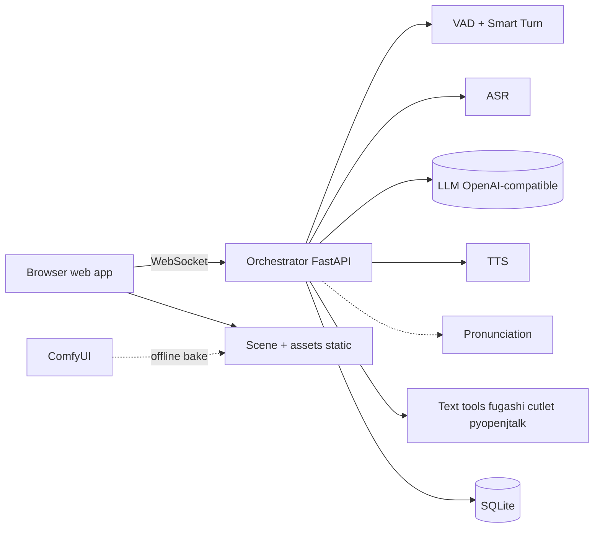

# Machi: local Japanese conversation tutor

**Working title:** Machi (町, "town"), guide character **Sora**

**Form:** Browser web app served from a local Docker Compose stack.

| Concern | Default choice |
| --- | --- |
| LLM | Any OpenAI-compatible endpoint (configure via env; never hardcode hosts or secrets) |
| ASR | Qwen3-ASR-0.6B (streaming); kotoba-whisper v2 on x86 3090 profile |
| TTS | Qwen3-TTS CustomVoice (NPCs); Irodori-TTS Small (Sora); Kokoro-82M (CPU fallback) |
| Turn-taking | Silero VAD + Smart Turn v3 (CPU) |
| Pronunciation | pyopenjtalk-plus, Qwen3-ForcedAligner, Japanese HuBERT phoneme CTC |
| Visuals | Pre-rendered scene art and sprite expressions (ComfyUI bake offline) |
| Licensing | Default stack Apache-2.0 / MIT / BSD (commercial-safe) |

**Key call:** Speech runs as VAD → ASR → LLM → TTS, not an end-to-end speech model. The tutor must see exact learner text, grade it, show furigana, and pick hint level.

## Goals and non-goals

**Goals**

- Speak to win: every scene requires saying the right thing out loud
- Real week-one situations: restaurant, konbini, directions, laundry, taxi, tickets
- Anime guide Sora sets the scene, plays staff, then coaches
- Adjustable help: English → romaji → kana → none
- Fully local on LAN; LLM-agnostic OpenAI-compatible API
- Commercial-safe default licenses

**Non-goals (v1)**

- Full JLPT course or kanji writing
- Native phone apps (mobile browser on LAN is OK)
- Cloud hosting, accounts, multi-user sync
- Real-time 3D or live image generation during conversation
- Fine-tuning models in v1

## Learner flow

1. **Pick a place** — illustrated neighborhood map; buildings are scenarios
2. **Briefing with Sora** — goal card and 3–5 key phrases with audio
3. **Warm-up** — repeat key phrases; light pronunciation scoring
4. **Role-play** — Sora as staff; learner speaks; subtitles with furigana at hint level
5. **Hint ladder** — silence, wrong move, or Help climbs one rung (lowers stars)
6. **Coach timeouts** — understandable mistakes get in-character NPC reaction + coach note
7. **Debrief** — stars, corrections, SRS deck updates, optional replay

### Scenarios

| Scenario | Setting | Win condition |
| --- | --- | --- |
| Restaurant (MVP) | Ramen / family restaurant | Seated, correct order, paid |
| Konbini | Counter checkout | Answer 3 staff questions |
| Directions | Street corner + mini-map | Reach station pin |
| Coin laundry | Laundromat | Start correct machine |
| Taxi | Rank and cab | Arrive and pay |
| Train ticket | Machine + window | Ticket + right platform |

### Levels and hint ladder

| Level | Default hint |
| --- | --- |
| 1 Tourist | English |
| 2 Survivor | Romaji |
| 3 Resident | Kana |
| 4 Local | No help |

Hint rungs: (1) English what to say, (2) Romaji, (3) Kana + tap-to-hear, (4) goal card only.

Each goal starts at the learner's level default (level 1 → rung 1 … level 4 → rung 4). Help, about 45 seconds without an accepted attempt, or a wrong move climbs one rung, capped at 4. Stars follow `success.stars`: 3 when the rung stays at the level default, 2 after one climb above that default, 1 after further climbs. The browser keeps `hint_max` per goal and sends it on each turn.

NPC synthesis and the tutor call run concurrently. The browser starts NPC playback as soon as the turn payload arrives. When the tutor is still running, the payload sets `coach_pending` and the coach drawer fills from `GET /sessions/{id}/coach` without holding the NPC line. Sora's expression is `happy`, `think`, `cheer`, `surprised`, `sorry`, or `point` (`sora_expression`, chosen from coach-note sentiment when the model omits it).

Lip flap reads the playing clip with an `AnalyserNode`. Silence keeps the mouth closed; a louder frame opens it. Tap-to-hear posts the phrase to `POST /v1/synthesize` on the orchestrator, which calls the TTS stub.

## Architecture

| Service | Stack |
| --- | --- |
| web | Vite + React; mic, scene, subtitles |
| orchestrator | Python FastAPI, asyncio, OpenAI SDK |
| asr | Qwen3-ASR or faster-whisper (GPU profiles) |
| tts | Qwen3-TTS / Irodori / Kokoro |
| pron | Aligner + phoneme CTC (async scoring) |
| assets | Static scenario art and sprites |
| db | SQLite on a volume |

WebSocket carries 16 kHz PCM frames on LAN (push-to-talk fallback for v1).

The browser captures mono audio with an AudioWorklet and sends **20 ms** Int16 frames (640 bytes) as binary WebSocket messages. JSON control events are `audio_start` (optional `hands_free`), `audio_stop`, and `turn`. The server replies with JSON only, including `{type: "audio_ack", frames: N}`. A `turn` without `text` runs the existing turn pipeline on PCM accumulated for that socket (`audio_b64`). A `turn` with `text` stays on the typed path. `npm run dev` logs each frame; set `VITE_LOG_PCM_FRAMES=0` to silence that.

Push-to-talk (`hands_free` false) does not run VAD or the turn scorer. The client ends the utterance with `turn`. Hands-free runs Silero VAD on each frame. After speech, a silence candidate (target 250 ms) is passed to the turn scorer. The default scorer is a silence-duration heuristic (no download). Optional Smart Turn v3 can cut earlier. Trailing silence still forces a cut at the **500 ms** ceiling, and the server emits `turn_result` on that cut. Microphone capture requires localhost or HTTPS.

`POST /sessions/{id}/turn` accepts `{ "audio_b64": "<pcm>" }` with no `text`. The orchestrator decodes that PCM, transcribes it at `ASR_URL` (`POST /v1/transcribe`), runs the NPC and tutor LLM calls on the transcript, then synthesizes the NPC line at `TTS_URL`. The JSON response includes `learner_text`, `npc.ja`, `npc.romaji`, and `tts_audio_b64`. A WebSocket `turn` that carries only `audio_b64` (or buffered PCM and no `text`) uses the same pipeline. Typed `text` still skips ASR. Blank `text` does not count as a typed turn.

Each turn logs one JSON line (`event: turn_latency`) with `stages_ms` for ASR, LLM, and TTS and a `cancelled` flag. HTTP `POST /sessions/{id}/turn` also sets `X-Latency-ASR`, `X-Latency-LLM`, and `X-Latency-TTS` (milliseconds). A stage that did not run — typed text skips ASR — is `null` in the log and its header is omitted. `cancelled` is false when the turn finishes. It is true when barge-in aborts the turn; stages that had already started still report elapsed time.

### Latency budget

Time is from the learner stopping to the first NPC audio. The M0 gate is under 2 s (`scripts/e2e_latency.py` prints p95 and asserts it only when `REAL=1`). That script clocks `POST /turn` (ASR → LLM → TTS) after push-to-talk has already ended the utterance, so the VAD + Smart Turn row is outside its measurement.

| Stage | Target | Ceiling |
| --- | --- | --- |
| End of speech (VAD + Smart Turn) | 250 ms | 500 ms |
| Final ASR | 150 ms | 300 ms |
| LLM first sentence | 350 ms | 700 ms |
| TTS first audio | 150 ms | 300 ms |
| **Total learner stop → NPC speaks** | **~1.0 s** | **~1.9 s** |

**Barge-in.** A session has one in-flight turn task. A new WebSocket `audio_start` or `turn` cancels that task (the ASR, LLM, and TTS awaits) and discards its result, so no stale `turn_result` is sent. Flow-engine updates from the cancelled turn are rolled back. The browser stops NPC playback as soon as a capture starts: push-to-talk press, or the start of a hands-free capture.

## Docker profiles

| Profile | Use |
| --- | --- |
| `spark` | DGX Spark aarch64, Qwen ASR/TTS stack |
| `rtx3090` | x86 speech on 3090; LLM remote via env |
| `cpu` | Demo/dev: lightweight stubs, no large model downloads |

See `docker-compose.yml` and `.env.example`.

## Scenario data format

One YAML file per scenario under `scenarios/`. See `scenarios/restaurant_ramen_01.yaml` for the reference restaurant MVP.

## Prompt design

Two LLM roles per turn:

- **NPC** — short in-character Japanese → TTS
- **Tutor (Sora)** — JSON: goal hits, correction, hint rung, coach note

Goal checks: fuzzy `accept` lists first, then LLM judgment.

NPC and learner lines are enriched with furigana and romaji via text tools, not from the LLM. Furigana is per-token ruby from fugashi + unidic-lite (`ruby_for_text`). A scenario `npc_kana` value is an optional whole-line override, used only when the spoken text still matches the scripted line. Romaji is cutlet Hepburn for any Japanese, including kanji. The web subtitle shows that romaji row for both the NPC line and the learner line when the hint level is 2 or higher. The level control defaults to 2. cutlet, fugashi, and unidic-lite are default orchestrator dependencies. If those imports fail, the original text is kept.

## Milestones

| Milestone | Done when |
| --- | --- |
| M0 Voice loop | Mic → ASR → LLM → TTS &lt; 2 s |
| M1 MVP ramen shop | Full scene, sprite, hints, debrief, SQLite |
| M2 Coaching | Pronunciation + FSRS review |
| M3 Neighborhood | Six map scenes |
| M4 Polish | L3/L4 curveballs, phone HTTPS |
| M5 Optional | Omni judge, scenario editor |

This repository PR targets the **scaffold + walking skeleton** toward M0/M1: CPU demo loop, one validated scenario, stubs for GPU services.

## License watch

Avoid in default stack: pykakasi (GPL), Fish Speech / F5-TTS / Style-Bert-VITS2 (NC/AGPL), and other NC models listed in the full product spec source canvas.