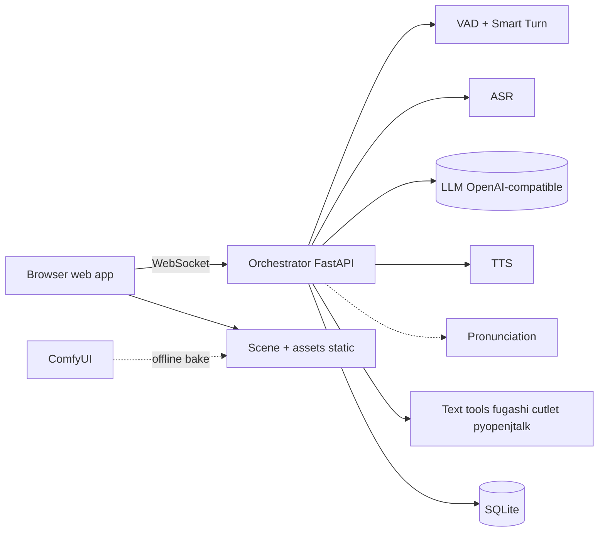

# Machi: local Japanese conversation tutor

**Working title:** Machi (町, "town"), guide character **Sora**

**Form:** Browser web app served from a local Docker Compose stack.

| Concern | Default choice |
| --- | --- |
| LLM | Any OpenAI-compatible endpoint (configure via env; never hardcode hosts or secrets) |
| ASR | Qwen3-ASR-0.6B (streaming); kotoba-whisper v2 on x86 3090 profile |
| TTS | Qwen3-TTS CustomVoice (NPCs); Irodori-TTS Small (Sora); Kokoro-82M (CPU fallback) |
| Turn-taking | Silero VAD + Smart Turn v3 (CPU) |
| Pronunciation | pyopenjtalk-plus, Qwen3-ForcedAligner, Japanese HuBERT phoneme CTC |
| Visuals | Pre-rendered scene art and sprite expressions (ComfyUI bake offline) |
| Licensing | Default stack Apache-2.0 / MIT / BSD (commercial-safe) |

**Key call:** Speech runs as VAD → ASR → LLM → TTS, not an end-to-end speech model. The tutor must see exact learner text, grade it, show furigana, and pick hint level.

## Goals and non-goals

**Goals**

- Speak to win: every scene requires saying the right thing out loud
- Real week-one situations: restaurant, konbini, directions, laundry, taxi, tickets
- Anime guide Sora sets the scene, plays staff, then coaches
- Adjustable help: English → romaji → kana → none
- Fully local on LAN; LLM-agnostic OpenAI-compatible API
- Commercial-safe default licenses

**Non-goals (v1)**

- Full JLPT course or kanji writing
- Native phone apps (mobile browser on LAN is OK)
- Cloud hosting, accounts, multi-user sync
- Real-time 3D or live image generation during conversation
- Fine-tuning models in v1

## Learner flow

1. **Pick a place** — illustrated neighborhood map; buildings are scenarios
2. **Briefing with Sora** — goal card and 3–5 key phrases with audio. A new session stays in this phase until the learner starts warm-up.
3. **Warm-up** — repeat each key phrase once. Matching is lenient (the phrase, its reading, romaji, or English). A miss does not fail the step. Role-play goal scoring stays off until the last phrase is attempted. Clients send `skip_warmup: true` on `POST /sessions/{id}/turn` to jump straight into role-play.
4. **Role-play** — Sora as staff; learner speaks; subtitles with furigana at hint level
5. **Hint ladder** — silence, wrong move, or Help climbs one rung (lowers stars)
6. **Coach timeouts** — understandable mistakes get in-character NPC reaction + coach note
7. **Debrief** — after the closing node (`debrief: true` in the scenario flow), the turn returns `type: debrief` with stars, the required goals from `success.required`, and up to two tutor corrections (Japanese with furigana and romaji, plus English). The two corrections are the highest weights (repeat misses plus hint climbs above the level default); a later phrase wins a tie. That turn writes the summary to SQLite and enrolls the session's correction cards in the FSRS deck. The debrief button "Add corrections to review" repeats that insert. Replay and return-to-briefing reset the same session and leave cards already in the deck.

`schema_version` records the SQLite schema. v2 adds `stars`, `max_hint_rung`, and `completed` on `sessions`, and `hint_rung`, `correction_ja`, and `correction_en` on `attempts`. A v1 file (sessions and attempts only) is altered in place. v3 adds `pitch_advisory` on attempts. v4 adds `corrections` (phrase, English, furigana in `kana_ruby`, romaji, scenario `srs_tags`, weight) and `cards` (FSRS state `new` / `learning` / `review`, due time, stability, difficulty, reps, lapses, last rating, and the copied tags). Debrief stores stars, the completion flag, and the max hint rung on the session, and one `hint:{goal_id}` attempt row per goal for the per-goal peak. `GET /sessions/{id}/progress` returns that summary plus spoken attempts. `GET /sessions` lists saved sessions.

### Scenarios

| Scenario | Setting | Win condition |
| --- | --- | --- |
| Restaurant (MVP) | Ramen / family restaurant | Seated, correct order, paid |
| Konbini | Counter checkout | Answer 3 staff questions |
| Directions | Street corner + mini-map | Reach station pin |
| Coin laundry | Laundromat | Start correct machine |
| Taxi | Rank and cab | Arrive and pay |
| Train ticket | Machine + window | Ticket + right platform |

Neighborhood files: `scenarios/konbini_checkout_01.yaml`, `scenarios/directions_01.yaml`, `scenarios/coin_laundry_01.yaml`, `scenarios/taxi_01.yaml`, `scenarios/train_ticket_01.yaml`. Each lists levels 1–4 with the default hint from the table below (`hint_defaults`). Directions adds hotspot `x`/`y` pins and `scene.ghost_path`, an SVG polyline the map UI can draw later. The street background is `bg/street.webp`.

Scene plates live under `assets/bg/` (`ramen`, `konbini`, `street`, `laundry`, `taxi`, `station`, `town_map` as `.webp`). Sora's expression plates are `assets/sprites/sora/{neutral,happy,think,cheer,surprised,sorry,point}.webp` on a green screen; the browser keys that green to alpha once per loaded file. `neutral.webp` is the resting face. `GET /scenarios` lists id, titles, and scene art (asset URLs). The town view (`#/town`) draws `town_map.webp` with a hotspot per building. The ramen shop is `restaurant_ramen_01`. A scenario with no hotspot stays locked.

### Levels and hint ladder

| Level | Default hint |
| --- | --- |
| 1 Tourist | English |
| 2 Survivor | Romaji |
| 3 Resident | Kana |
| 4 Local | No help |

Hint rungs: (1) English what to say, (2) Romaji, (3) Kana + tap-to-hear, (4) goal card only.

Each goal starts at the learner's level default (level 1 → rung 1 … level 4 → rung 4). Help, about 45 seconds without an accepted attempt, or a wrong move climbs one rung, capped at 4. Stars follow `success.stars`: 3 when the rung stays at the level default, 2 after one climb above that default, 1 after further climbs. The browser keeps `hint_max` per goal and sends it on each turn.

NPC synthesis and the tutor call run concurrently. The browser starts NPC playback as soon as the turn payload arrives. When the tutor is still running, the payload sets `coach_pending` and the coach drawer fills from `GET /sessions/{id}/coach` without holding the NPC line. Sora's expression is `happy`, `think`, `cheer`, `surprised`, `sorry`, or `point` (`sora_expression`, chosen from coach-note sentiment when the model omits it).

Lip flap reads the playing clip with an `AnalyserNode`. Silence keeps the mouth closed; a louder frame opens it. Tap-to-hear posts the phrase to `POST /v1/synthesize` on the orchestrator, which calls the TTS stub.

## Architecture

| Service | Stack |
| --- | --- |
| web | Vite + React; mic, scene, subtitles |
| orchestrator | Python FastAPI, asyncio, OpenAI SDK |
| asr | Qwen3-ASR or faster-whisper (GPU profiles) |
| tts | Qwen3-TTS / Irodori / Kokoro |
| pron | CPU pyopenjtalk readings + librosa.pyin F0 advisory. Aligner and phoneme CTC come later |
| assets | Static scenario art and sprites |
| db | SQLite on a volume |

WebSocket carries 16 kHz PCM frames on LAN (push-to-talk fallback for v1).

The browser captures mono audio with an AudioWorklet and sends **20 ms** Int16 frames (640 bytes) as binary WebSocket messages. JSON control events are `audio_start` (optional `hands_free`), `audio_stop`, and `turn`. The server replies with JSON only, including `{type: "audio_ack", frames: N}`. A `turn` without `text` runs the existing turn pipeline on PCM accumulated for that socket (`audio_b64`). A `turn` with `text` stays on the typed path. `npm run dev` logs each frame; set `VITE_LOG_PCM_FRAMES=0` to silence that.

Push-to-talk (`hands_free` false) does not run VAD or the turn scorer. The client ends the utterance with `turn`. Hands-free runs Silero VAD on each frame. After speech, a silence candidate (target 250 ms) is passed to the turn scorer. The default scorer is a silence-duration heuristic (no download). Optional Smart Turn v3 can cut earlier. Trailing silence still forces a cut at the **500 ms** ceiling, and the server emits `turn_result` on that cut. Microphone capture requires a secure context: localhost or HTTPS. A LAN IP on plain HTTP is not enough. `scripts/make_lan_https.sh` writes a self-signed certificate (SAN for the LAN IP, optional Tailscale IP, and localhost) under `.certs/`. Compose profile `https` serves it on port 5174 (`HTTPS=1`); port 5173 stays HTTP. The browser then uses `wss://` for `/api/ws`.

`POST /sessions/{id}/turn` accepts `{ "audio_b64": "<pcm>" }` with no `text`. The orchestrator decodes that PCM, transcribes it at `ASR_URL` (`POST /v1/transcribe`), runs the NPC and tutor LLM calls on the transcript, then synthesizes the NPC line at `TTS_URL`. The JSON response includes `learner_text`, `npc.ja`, `npc.romaji`, and `tts_audio_b64`. A WebSocket `turn` that carries only `audio_b64` (or buffered PCM and no `text`) uses the same pipeline. Typed `text` still skips ASR. Blank `text` does not count as a typed turn.

Each clip is decoded from its own samples. A recording whose loudest sample is essentially zero is not passed to the model: that waveform otherwise comes back as the same short word on every hold. The browser leaves echo cancellation, noise suppression, and automatic gain off so the PCM is the microphone. Push-to-talk sends the clip on the session WebSocket. If that socket is closed, the same bytes are posted to `/sessions/{id}/turn` instead of leaving the previous transcript up. A session the server has dropped is replaced, and the page says the recording was not transcribed.

A spoken turn also builds an interpretation: the words that were recognized, and how to say the phrase the learner was aiming for. Sora says those as two clips, both with `language: Auto`. The first clip is only what was recognized. The second is how to say the phrase, and on a miss it starts with "Correction." so that sentence is a separate moment. During warm-up the interpretation clip is `tts_audio_b64` and the model phrase is `pronounce_audio_b64`. During role-play the shop line stays in `tts_audio_b64`, the interpretation is `coach_audio_b64`, and the model phrase is `pronounce_audio_b64`. The browser plays the shop line, then the interpretation, then the correction, and highlights the correction line while that clip is playing.

Fixed `flow.nodes.*.npc` lines can be baked with `scripts/bake_npc_audio.py`. The script posts each line to `TTS_URL/v1/synthesize` and writes `assets/audio/{scenario_id}/{node_id}.wav` plus `manifest.json` (`lines` maps node id to filename). On a turn, if the spoken text is still that node's `npc` line and the file exists under `ASSETS_PATH`, the response uses the file as `tts_audio_b64`. Otherwise the orchestrator calls live TTS. The restaurant scenario ships CPU-stub wavs; regenerate them with the script when a real voice is available.

Each turn logs one JSON line (`event: turn_latency`) with `stages_ms` for ASR, LLM, and TTS, a `sources` object, and a `cancelled` flag. TTS source is `cache` or `live`. HTTP `POST /sessions/{id}/turn` also sets `X-Latency-ASR`, `X-Latency-LLM`, `X-Latency-TTS` (milliseconds), and `X-Latency-TTS-Source` when TTS ran. A stage that did not run — typed text skips ASR — is `null` in the log and its header is omitted. `cancelled` is false when the turn finishes. It is true when barge-in aborts the turn; stages that had already started still report elapsed time.

### Latency budget

Time is from the learner stopping to the first NPC audio. The M0 gate is under 2 s (`scripts/e2e_latency.py` prints p95 and asserts it only when `REAL=1`). That script clocks `POST /turn` (ASR → LLM → TTS) after push-to-talk has already ended the utterance, so the VAD + Smart Turn row is outside its measurement.

| Stage | Target | Ceiling |
| --- | --- | --- |
| End of speech (VAD + Smart Turn) | 250 ms | 500 ms |
| Final ASR | 150 ms | 300 ms |
| LLM first sentence | 350 ms | 700 ms |
| TTS first audio | 150 ms | 300 ms |
| **Total learner stop → NPC speaks** | **~1.0 s** | **~1.9 s** |

**Barge-in.** A session has one in-flight turn task. A new WebSocket `audio_start` or `turn` cancels that task (the ASR, LLM, and TTS awaits) and discards its result, so no stale `turn_result` is sent. Flow-engine updates from the cancelled turn are rolled back. The browser stops NPC playback as soon as a capture starts: push-to-talk press, or the start of a hands-free capture.

## Docker profiles

| Profile | Use |
| --- | --- |
| `spark` | DGX Spark aarch64. Speech runs here only when the 3090 is absent |
| `rtx3090` | Default speech host (x86). LLM stays remote via env |
| `cpu` | Demo/dev: lightweight stubs, no large model downloads |

When both GPUs are up, ASR and TTS stay on the 3090 so Spark can serve the LLM and ComfyUI. See [ADR-001](ADR-001-speech-placement.md). Knobs: `GPU_MEM_FRACTION`, `ASR_ENGINE`, `GPU_BASE`, `SPEECH_PROFILE`.

Sora and NPC voices resolve through `voices/voices.yaml` (Irodori v4.1 Small, then Kokoro, then stub for Sora; Qwen3-TTS `Ono_Anna` for each NPC). The web shows Sora's seven expression plates and stacks the scene, subtitles, and controls in a 9:16 crop at viewport widths of 480px and below.

See `docker-compose.yml` and `.env.example`.

## Scenario data format

One YAML file per scenario under `scenarios/`. See `scenarios/restaurant_ramen_01.yaml` for the reference restaurant MVP.

A flow node with `kind: branch` is not spoken. It carries `condition.level_gte` (an integer from 1 to 4) and two targets, `high` and `low`. When the engine enters that node it compares the session's learner level: `level >= level_gte` follows `high`, otherwise `low`. The choice is resolved before the turn's NPC line is chosen, so the client still sees one ordinary turn. The ramen shop uses this on the order: levels 3 and 4 are asked 硬め・普通・やわらかめ (`noodle_firmness`, accepted as かため / ふつう / やわらかめ and romaji such as katame, futsuu, yawarakame). Levels 1 and 2 take `low` and go straight to the order confirmation. A miss stays on the firmness node and Sora's retry note is that goal's `coach_en`.

`POST /scenarios/validate` runs that YAML through the same loader and Pydantic models and returns structured errors (path, message, line when the parser has one). It does not write a file. `GET /scenarios/{id}/raw` returns the on-disk text. The browser editor is `#/editor`: validate, then export a `.yaml` blob once the draft is valid.

Scene plates are baked offline with `tools/comfyui_bake.py` (ComfyUI Qwen Image 2511, WebP into `assets/`). That script is not part of `docker compose up` and must not restart ComfyUI. A real run requires `COMFY_BAKE_GO=1`.

## Prompt design

Two LLM roles per turn:

- **NPC** — short in-character Japanese → TTS
- **Tutor (Sora)** — JSON: goal hits, correction, hint rung, coach note

Prompt text lives in `orchestrator/prompts/` (`npc_system.md`, `npc_user.md`, `tutor_system.md`, `tutor_user.md`, and `coach_note_*.md`). The orchestrator fills `{{placeholders}}`. Tutor JSON is validated: `goal_hits`, `correction_en`, `coach_note_en`, `hint_rung` 1–4, and `sora_expression` (`happy`, `think`, `cheer`, `surprised`, `sorry`, `point`). Optional `correction_ja` is the phrase the debrief shows with furigana. One repair retry appends the validation error; if that is still invalid, the mock tutor payload is used.

Goal checks: fuzzy `accept` lists first, then LLM judgment.

### Pronunciation (advisory)

`pron/` is a CPU FastAPI service. `POST /reading` with `{text}` returns katakana, accent type, and a per-mora H/L pattern from **pyopenjtalk** full-context labels (`/F:` accent position, `/A:` mora index). OpenJTalk's heiban (平板) is accent position equal to the mora count; the API reports that as accent type 0. The package is MIT and OpenJTalk plus its dictionary are Modified BSD. **pyopenjtalk-plus is not used.** Those labels already carry the expected reading, so the plus fork and the optional `marine` accent model are unnecessary. `pron/scripts/fetch_dict.sh` downloads the dictionary at image build (`OPEN_JTALK_DICT_DIR` inside the wheel) so the first request does not need the network.

`POST /f0` accepts 16 kHz mono PCM16 as a WAV or raw bytes (`audio_b64`) and returns `frames_hz`, `voiced_ratio`, and `mean_f0` from **librosa.pyin** (ISC). No torch. `POST /score` slices that F0 track across the expected moras and labels each mora `flat`, `rising`, or `dropping`, then `ok`, `low`, or `high`. The body always includes `is_advisory: true` and `blocks_turn: false`. Equal-time slices are a stand-in until forced alignment.

The orchestrator calls `pron_reading` while it builds Sora's prompt (`Expected reading` in `tutor_user.md`). `PRON_URL` empty, or any error inside 1.5 s, becomes the word `unavailable` and the turn continues. When the learner turn includes audio, `pron_score` runs beside the NPC call and the JSON is stored on the attempt as `pitch_advisory` (schema v3). Stars still come only from hint climbs. The debrief shows one muted line when that JSON exists. The coach panel reads the same object.

NPC and learner lines are enriched with furigana and romaji via text tools, not from the LLM. Furigana is per-token ruby from fugashi + unidic-lite (`ruby_for_text`). A scenario `npc_kana` value is an optional whole-line override, used only when the spoken text still matches the scripted line. Romaji is cutlet Hepburn for any Japanese, including kanji. The web subtitle shows that romaji row for both the NPC line and the learner line when the hint level is 2 or higher. The level control defaults to 2. cutlet, fugashi, and unidic-lite are default orchestrator dependencies. If those imports fail, the original text is kept.

### Review deck (FSRS-4.5)

Role-play stores a row whenever the tutor JSON includes `correction_ja` or `correction_en`. A warm-up miss stores the key phrase the same way (no extra LLM call). Weight is how many times that phrase was missed, plus hint-rung climbs above the level default. The same Japanese line updates one row instead of inserting a duplicate.

Finishing the scenario inserts one card per correction row (`POST /sessions/{id}/reviews` does the same insert and is safe to repeat). Cards start in state `new`, due immediately, with the scenario `srs_tags` copied onto the card. `GET /reviews/next?limit=` returns due cards soonest first, including the phrase, furigana, romaji, and tags. `POST /reviews` body `{ "card_id", "rating" }` with rating `again`, `hard`, `good`, or `easy` runs the in-tree scheduler in `orchestrator/machi/fsrs.py` (stdlib and `math` only). Default weights are the MIT py-fsrs / fsrs4py FSRS-4.5 parameters. A first Good on a new card moves it to `review`. Again or Hard on a new card stays `learning`. Desired retention is 0.9 and intervals are not fuzzed.

Starting any scenario pulls up to two due cards whose tags overlap that scenario's `srs_tags`. The briefing adds a "From your reviews" line, and those phrases are extra warm-up items (still lenient). `skip_warmup` skips them and does not grade the card. Answering one applies the same fuzzy grade as a spoken review (good / hard / again) and increments reps. The six scenario files share more than one tag across scenes (`ordering` on restaurant, konbini, and taxi; `counters`; `payment`; `station`), so a low-weight miss in the ramen shop can show up at the konbini or in a taxi.

`POST /review/sessions` opens a two-minute spoken review (REST, up to eight due cards, soft 120 s budget). The response includes Sora's mini-situation from `orchestrator/prompts/review_situation_<tag>.md`, picked from the cards' tags. `POST /review/sessions/{id}/answer` takes `text` or `audio_b64` (audio goes through ASR) and an optional `self_rating` of `again`, `hard`, `good`, or `easy`. With no self rating, a full phrase is good, a fragment is hard, and a miss is again. `GET /review/sessions/{id}` returns progress; a finished session includes how many cards were reviewed and their next due times. The session lives in memory; each answer is written to the FSRS card immediately. On the CPU profile the ASR stub returns `ふたりです` for any audio, so a spoken review scores that fixed line unless you type the phrase. TTS is the existing stub if the learner taps Hear. The town screen starts this with "Review (2 min)".

## Milestones

| Milestone | Done when |
| --- | --- |
| M0 Voice loop | Mic → ASR → LLM → TTS &lt; 2 s |
| M1 MVP ramen shop | Full scene, sprite, hints, debrief, SQLite |
| M2 Coaching | Pronunciation + FSRS review |
| M3 Neighborhood | Six map scenes |
| M4 Polish | L3/L4 curveballs, phone HTTPS |
| M5 Optional | Omni judge, scenario editor |

This repository PR targets the **scaffold + walking skeleton** toward M0/M1: CPU demo loop, one validated scenario, stubs for GPU services.

## License watch

Avoid in default stack: pykakasi (GPL), Fish Speech / F5-TTS / Style-Bert-VITS2 (NC/AGPL), and other NC models listed in the full product spec source canvas.

Pronunciation uses pyopenjtalk (MIT) and OpenJTalk (Modified BSD), plus librosa (ISC) and its BSD numeric stack. No GPL or non-commercial weights.